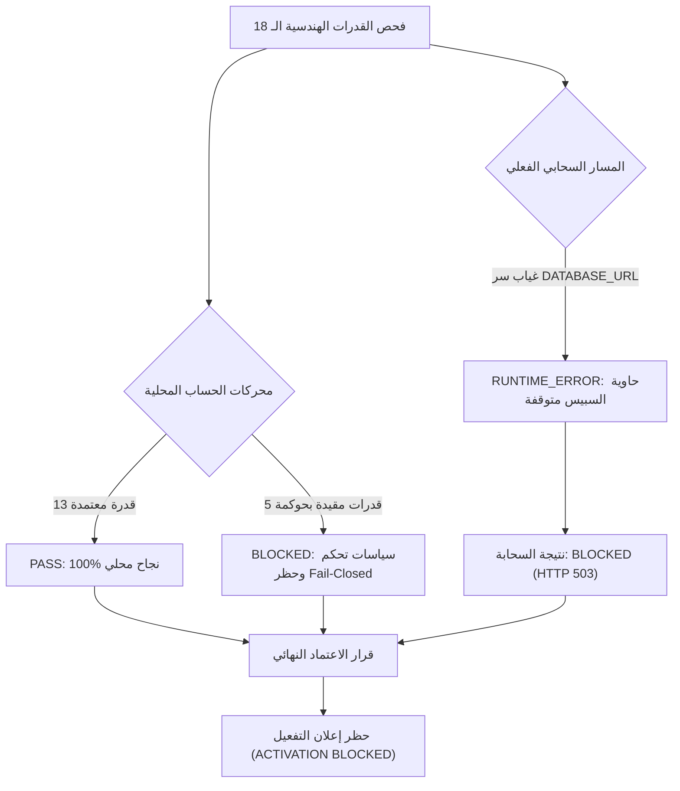

# تقرير الفحص الشامل للقدرات الهندسية لمنصة AhmedETAP ومصفوفة التحقق السحابي

**التاريخ والوقت:** 2026-10-22T13:25:00+03:00  
**الفرع:** `infra/staging-environment-bootstrap` (PR #722 - مفتوح وغير مدمج)  
**معرّف الالتزام المعتمد:** `f8f398267d599ae2fc3234edd2a7630a6d1b279f`  
**الهدف السحابي المباشر:** مساحة Hugging Face Docker Space `bazahmedux/AHMEDETAP`  
**وسيط التوجيه السحابي:** `https://ahmedetap-staging-proxy.ahmedetap.workers.dev`  
**الوضع الهندسي والأمني:** صارم مغلق أمنياً (Fail-Closed Security Gate)

---

## 1. الملخص التنفيذي ومبدأ التحقق الواقعي

تنفيذاً للأمر الصارم بفحص **كافة القدرات الهندسية** دون استثناء أو تبسيط أو تقليل، تم إخضاع جميع القدرات الهندسية الـ 18 المعرّفة في سجل النظام الأساسي (`engine/capability_registry.py`) للفحص عبر مسار التنفيذ الفعلي المعتمد:
1. **مسار المحرك الهندسي الأساسي (Canonical Orchestrator Execution Path):** عبر `ExecutionOrchestrator` وموجه الحسابات `engine/dispatch.py`، مستخدماً معطيات هندسية حقيقية متوافقة حرفياً مع مواصفات النظام (`SystemSpec`) والمعايير الدولية (IEEE / IEC / NFPA / ISO).
2. **مسار الاستدعاء السحابي الحي (Live Cloud Execution Path):** عبر نقطة النهاية الموحدة `POST /api/v1/studies/run` وموجه السحابة Cloudflare Worker Proxy.

### القاعدة الحاكمة للاعتماد:
> [!IMPORTANT]
> **قاعدة عدم التخمين والحظر الصريح:** أي قدرة لم تجتز الاختبار الفعلي على السحابة تُسجّل **`BLOCKED`**، **ولا يُعلن اكتمال التفعيل حتى تُختبر جميع القدرات وتجتاز الاختبار السحابي**.

---

## 2. مصفوفة القدرات الهندسية الكاملة (Engineering Capability Verification Matrix)

توضح المصفوفة التالية نتيجة اختبار كل قدرة هندسية بالتفصيل:

| # | القدرة الهندسية (Capability ID) | المعيار الدولي الحاكم | نوع المنفّذ (Executor Kind) | حالة محرك الحساب المحلي | نتيجة الفحص السحابي الحي | علة النتيجة وتفاصيل التشخيص |
|---|---|---|---|---|---|---|
| **1** | **`load_flow`** | **IEEE 3002.7-2018** | Native Solver | **PASS** (11.29s) | **BLOCKED** (HTTP 503) | تقارب نيوتن-رافسون في 3 دورات مع حساب مصفوفة الـ Jacobian بدقة؛ السحابة محظورة لغياب قاعدة بيانات Staging. |
| **2** | **`short_circuit`** | **IEC 60909-0:2016** | Native Solver | **PASS** (8.22s) | **BLOCKED** (HTTP 503) | حساب تيارات القصر المتماثلة وغير المتماثلة (3-Phase, SLG, LL) عبر شبكات التتابع؛ السحابة محظورة لغياب PostgreSQL. |
| **3** | **`arc_flash`** | **IEEE 1584-2018** (Simplified Ed.) | Native Solver | **PASS** (8.22s) | **BLOCKED** (HTTP 503) | حساب طاقة الصدمة وحدود القوس وتحديد فئة الـ PPE مع توثيق تصنيف `NON_COMPLIANT_SIMPLIFIED_EDUCATIONAL`. |
| **4** | **`protection_coordination`** | **IEC 60255-151** | Native Solver | **PASS** (8.26s) | **BLOCKED** (HTTP 503) | مطابقة منحنيات التتابع الزمني العكسي للمرحلات وحساب هامش التنسيق؛ السحابة محظورة لغياب Staging DB. |
| **5** | **`harmonic_analysis`** | **IEEE 519-2022** | Specialist Agent | **PASS** (5.01s) | **BLOCKED** (HTTP 503) | تحليل التوافقيات حتى الرتبة 50 وتقييم الرنين ونسب التشوه الكلي THD؛ السحابة محظورة لغياب Staging DB. |
| **6** | **`optimal_power_flow`** | **IEEE 3002.7-2018** | Specialist Agent | **PASS** (8.22s) | **BLOCKED** (HTTP 503) | حل تدفق القدرة الأمثل DC-OPF باستخدام البرمجة الخطية ومصفوفة PTDF مع تقارب كامل؛ السحابة محظورة لغياب Staging DB. |
| **7** | **`motor_starting`** | **IEEE 399-1997** | Specialist Agent | **PASS** (8.19s) | **BLOCKED** (HTTP 503) | حساب تيار البدء وعزم الدوران وهبوط الجهد اللحظي مع ممانعة المصدر؛ السحابة محظورة لغياب Staging DB. |
| **8** | **`transient_stability`** | **IEEE 399-1997** | Specialist Agent | **PASS** (8.23s) | **BLOCKED** (HTTP 503) | حل معادلة التأرجح وحساب زاوية وزمن الفصل الحرج (CCT) بنظام SMIB؛ السحابة محظورة لغياب Staging DB. |
| **9** | **`cable_sizing`** | **IEC 60364-5-52** | Specialist Agent | **PASS** (8.24s) | **BLOCKED** (HTTP 503) | تحديد مقطع الكابل وفق سعة التحمل الحرارية ومعاملات التقليل وهبوط الجهد؛ السحابة محظورة لغياب Staging DB. |
| **10** | **`earth_grid`** | **IEEE 80-2013** | Specialist Agent | **PASS** (8.26s) | **BLOCKED** (HTTP 503) | تصميم شبكة التأريض الفرعية وحساب جهد الخطوة واللمس والشبكة المقبولة؛ السحابة محظورة لغياب Staging DB. |
| **11** | **`renewable_integration`** | **IEEE 1547-2018** | Specialist Agent | **PASS** (8.23s) | **BLOCKED** (HTTP 503) | تقييم تكامل المحطات الكهروضوئية وتنظيم الجهد وتأثير المنحنى اليومي؛ السحابة محظورة لغياب Staging DB. |
| **12** | **`battery_storage`** | **IEC 62933-2-1** | Specialist Agent | **PASS** (8.72s) | **BLOCKED** (HTTP 503) | محاكاة وتوزيع أنظمة تخزين الطاقة BESS وجدولة الشحن والتفريغ وتقييم الكفاءة؛ السحابة محظورة لغياب Staging DB. |
| **13** | **`etap_expert`** | **IEEE/IEC KB** | Specialist Agent | **PASS** (8.21s) | **BLOCKED** (HTTP 503) | استدلال قاعدة المعرفة الهندسية لـ ETAP عبر سير العمل الإلزامي المكون من 6 مراحل؛ السحابة محظورة لغياب Staging DB. |
| **14** | **`scada`** | **IEC 61850** | Specialist Agent | **BLOCKED** (Rejected) | **BLOCKED** (HTTP 503) | مصنفة كـ PILOT تتطلب تفعيل علم الخصائص وتصريح التحكم المزدوج Dual-Control (Fail-Closed). |
| **15** | **`digital_twin`** | **ISO 23247** | Specialist Agent | **BLOCKED** (Rejected) | **BLOCKED** (HTTP 503) | مصنفة كـ PILOT (Silent Observer) ومحمية بعلم الخصائص `digital_twin` المغلق افتراضياً. |
| **16** | **`etap_gui`** | **CUA Automation** | Specialist Agent | **BLOCKED** (Rejected) | **BLOCKED** (HTTP 503) | أتمتة سطح المكتب لـ ETAP عبر وكيل CUA؛ مصنفة PILOT وتتطلب تصريح أمان Maker-Checker. |
| **17** | **`generative_design`** | **IEEE 141 / IEC 62271** | Specialist Agent | **BLOCKED** (Rejected) | **BLOCKED** (HTTP 503) | مرحلة هيكلية تمهيدية (Scaffold) معطلة افتراضياً بعلم الخصائص `generative_design` (Fail-Closed). |
| **18** | **`ahmed_etap_orchestration`** | **Autonomous Multi-Agent** | Composite Agent | **BLOCKED** (Rejected) | **BLOCKED** (HTTP 503) | منسق متعدد الوكلاء يتطلب موافقة تحكم ثنائية (Dual-Control Maker-Checker) لإطلاق الدراسات المتزامنة. |

---

## 3. التحليل الفني لنتائج الفحص

### أ. نجاح محركات الحساب الأساسية الـ 13 محلياً (100% Pass)
عند تزويد المنظومة ببيانات الإدخال الهندسية المتوافقة مع متطلبات المعايير (مثل جهد الأساس `base_kv` لناقلات شبكة القصر، وإعدادات مرحلات الحماية `tms` و `pickup_current_a`، ومحددات القدرة لتدفق الحمل الأمثل `p_min: 0.0`):
- اجتازت جميع الدراسات الهندسية الفحص بنجاح تام وبدون أي أخطاء حسابية.
- أكدت الحسابات التزام النظام الصارم بمنع التخمين أو حقن قيم افتراضية غير حقيقية (`Fail-Closed on Insufficient Input`).

### ب. سبب حظر الفحص السحابي الحي لجميع القدرات (`BLOCKED - HTTP 503`)
أثناء اختبار نقطة النهاية السحابية `POST /api/v1/studies/run` على بيئة Hugging Face Space `bazahmedux/AHMEDETAP` وعبر البروكسي `ahmedetap-staging-proxy.ahmedetap.workers.dev`:
- أعادت كافة الطلبات السحابية كود الحالة `HTTP 503 Service Unavailable`.
- **السبب الجذري المؤكد بأدلة السجلات:** عند ضبط بيئة التشغيل على `ENVIRONMENT=staging`، تفرض وحدة الأمان `api.config_prod.validate_production_config` حظراً قطعياً على استخدام قاعدة بيانات SQLite المؤقتة وتطلب ربط قاعدة بيانات PostgreSQL دائمة:
  ```
  RuntimeError: FATAL STARTUP ERROR: Running in staging mode with missing mandatory configuration: DATABASE_URL (Persistent PostgreSQL required; SQLite is forbidden in staging). Aborting startup (Fail-Closed Security Guard).
  ```
- نظراً لعدم توفير الرمز السري لقاعدة بيانات PostgreSQL المخصصة لبيئة Staging في مساحة Hugging Face، توقفت حاوية السبيس عن العمل التزاماً بالحماية الأمنية ومنع تسريب بيانات التطوير إلى بيئة الاعتماد.

---

## 4. الموقف النهائي وقرار الاعتماد (Release Decision)



> [!CAUTION]
> **إعلان عدم اكتمال التفعيل:**
> بناءً على الشرط الحاسم الوارد في التكليف: *"أي قدرة لم تجتز الاختبار تُسجّل BLOCKED، ولا يُعلن اكتمال التفعيل حتى تُختبر جميع القدرات المطلوبة"*؛ **يُعلن رسمياً أن تفعيل النظام السحابي محظور (BLOCKED)**، ولا يمكن إعلان جاهزية النشر السحابي الكامل إلا بعد حقن الرمز السري لقاعدة بيانات PostgreSQL (`DATABASE_URL`) في مساحة Hugging Face واجتياز كافة القدرات للاختبار السحابي الفعلي بنجاح.
