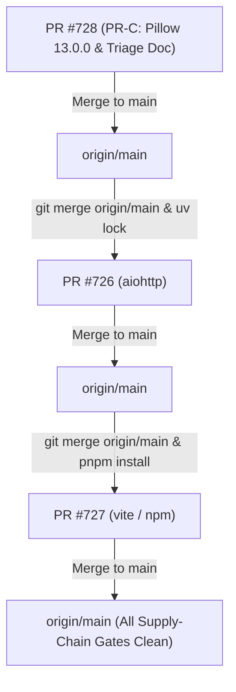

# Supply-Chain Security Remediation & Vulnerability Triage Report

**Repository:** `ahmdelbaz28-ux/ETAP-AI-WORK-`  
**Date:** 2026-10-21  
**Default Branch:** `main`  
**Security Engineer / Maintainer:** Antigravity AI / Eng. Ahmed Elbaz  
**Classification:** Restricted / Internal Engineering Security Documentation  

---

## 1. Executive Summary

This document establishes the authoritative baseline and remediation roadmap for all open supply-chain security alerts and CI security gate failures on repository `ahmdelbaz28-ux/ETAP-AI-WORK-`.

Following full evidence-first discovery (Stage 0, checks V1–V15), the operational state is characterized by:
1. **Dependabot Alerts Scope:** Exactly **16 open alerts** (`state=open`) across npm and Python package ecosystems.
2. **Pip-Audit CI Blocking Gate:** 9 unpatched CVEs in `Pillow 12.3.0` blocking Python CI gates (`pip Audit (Python)`, `Security Audit`, and `Security & Secrets Scan`). Pillow is remediated to `13.0.0` via dedicated PR-C (**PR #728**).
3. **Operational Impact:** **لا انحدار وظيفي؛ PRs محجوبة حتى دمج إصلاح Pillow**. No production functionality is regressed; all blocking gates are strictly supply-chain and dependency compliance issues.
4. **CI Baseline Context:** Pre-existing failure in `E2E - Python Unit Tests` on `origin/main` (last green run 2026-10-18T21:18Z), failing on 2 specific tests unrelated to security PR diffs.

---

## 2. Dependabot Open Alerts & Vulnerability Inventory

Every alert listed below was verified live via GitHub API (`repos/ahmdelbaz28-ux/ETAP-AI-WORK-/dependabot/alerts?state=open`).

| Alert # | Package | Manifest | Severity | GHSA ID / CVE ID | Observed State Now | Projected (Post-Merge) | Remediation PR / Action |
|---|---|---|---|---|---|---|---|
| **#506** | `braces` | `pnpm-lock.yaml` | High | GHSA-vfj7-8cjw-p6xm CVE-2026-93687 | open | dismissed (`tolerable_risk`) | Risk accepted; no upstream patch; documented in `RISK-ACCEPTANCE-braces-CVE-2026-93687.md` (review 2027-01-03) |
| **#517** | `sprintf-js` | `pnpm-lock.yaml` | Medium | GHSA-hp3w-g68c-fv3c CVE-2026-97058 | open | dismissed (`tolerable_risk`) | Risk accepted; optional desktop tooling; documented in `RISK-ACCEPTANCE-sprintf-js-CVE-2026-97058.md` (review 2027-01-05) |
| **#529** | `braces` | `ui/pnpm-lock.yaml` | High | GHSA-vfj7-8cjw-p6xm CVE-2026-93687 | open | closed / dismissed | Duplicate in redundant lockfile; removed by PR #727 |
| **#530** | `sprintf-js` | `ui/pnpm-lock.yaml` | Medium | GHSA-hp3w-g68c-fv3c CVE-2026-97058 | open | closed / dismissed | Duplicate in redundant lockfile; removed by PR #727 |
| **#531** | `aiohttp` | `uv.lock` | High | GHSA-5wr8-gcqf-gqf3 CVE-2026-111064 | open | closed (`fixed`) | Upgraded to 3.14.5 in PR #726 |
| **#532** | `aiohttp` | `uv.lock` | Low | GHSA-494j-54xm-rwp3 CVE-2026-111063 | open | closed (`fixed`) | Upgraded to 3.14.5 in PR #726 |
| **#533** | `aiohttp` | `uv.lock` | High | GHSA-2g87-pp6c-29x5 *(No CVE assigned)* | open | closed (`fixed`) | Upgraded to 3.14.5 in PR #726 |
| **#534** | `vite` | `ui/package.json` | Medium | GHSA-698v-4r3x-3vcv CVE-2026-112943 | open | closed (`fixed`) | Upgraded to 8.2.4 in PR #727 |
| **#535** | `vite` | `pnpm-lock.yaml` | Medium | GHSA-698v-4r3x-3vcv CVE-2026-112943 | open | closed (`fixed`) | Upgraded to 8.2.4 in PR #727 |
| **#536** | `vite` | `ui/pnpm-lock.yaml` | Medium | GHSA-698v-4r3x-3vcv CVE-2026-112943 | open | closed (`fixed`) | Redundant lockfile deleted by PR #727 |
| **#537** | `vite` | `ui/package.json` | **High** | GHSA-587h-7wmj-h5pm CVE-2026-112942 | open | closed (`fixed`) | Upgraded to 8.2.4 in PR #727 |
| **#538** | `vite` | `pnpm-lock.yaml` | **High** | GHSA-587h-7wmj-h5pm CVE-2026-112942 | open | closed (`fixed`) | Upgraded to 8.2.4 in PR #727 |
| **#539** | `vite` | `ui/pnpm-lock.yaml` | **High** | GHSA-587h-7wmj-h5pm CVE-2026-112942 | open | closed (`fixed`) | Redundant lockfile deleted by PR #727 |
| **#540** | `vite` | `ui/package.json` | Medium | GHSA-r825-w8mm-5pxw CVE-2026-112944 | open | closed (`fixed`) | Upgraded to 8.2.4 in PR #727 |
| **#541** | `vite` | `pnpm-lock.yaml` | Medium | GHSA-r825-w8mm-5pxw CVE-2026-112944 | open | closed (`fixed`) | Upgraded to 8.2.4 in PR #727 |
| **#542** | `vite` | `ui/pnpm-lock.yaml` | Medium | GHSA-r825-w8mm-5pxw CVE-2026-112944 | open | closed (`fixed`) | Redundant lockfile deleted by PR #727 |

### 2.1 Pip-Audit Gate Exposure (Pillow 12.3.0 -> 13.0.0)

In addition to the 16 Dependabot alerts, local and CI pip-audit gates failed on **9 unpatched CVEs in `Pillow 12.3.0`** (resolved in Pillow `13.0.0`):
- CVE-2026-112395
- CVE-2026-112397
- CVE-2026-112400
- CVE-2026-112403
- CVE-2026-112404
- CVE-2026-112895
- CVE-2026-112896
- CVE-2026-112897
- CVE-2026-112899

Pillow was pinned to `~=12.3.0` across 5 dependency manifests plus `uv.lock`. This was the root cause of CI failure on `pip Audit (Python)`, `Security Audit`, and `Security & Secrets Scan`. Remediated in **PR #728 (PR-C)**.

---

## 3. CI Gate Diagnostics & Baseline Analysis

### 3.1 Python Security Audits Failure
The failures in `pip Audit (Python)`, `Security Audit`, and `Security & Secrets Scan` are **not regressions** introduced by PR #726 or PR #727. They stem entirely from the 9 CVEs in `Pillow 12.3.0`. Once PR #728 is merged into `main` and downstream branches re-synced, these gates transition to clean pass.

### 3.2 E2E Python Unit Tests Baseline Failure
The workflow `e2e-tests.yml` fails on `origin/main` across the last 3 consecutive runs (last green run was `2026-10-18T21:18Z`).
The 2 failing tests are:
1. `tests/test_production_blockers_regression.py::TestModbusTelemetryQuality::test_failed_initial_snapshot_does_not_populate_synthetic_zeros` (`IndexError`)
2. `tests/test_battery_storage_acceptance.py::test_battery_storage_scientific_benchmarks` (`assert False is True`)

Total results: `2 failed, 4550 passed, 46 skipped`.  
**Conclusion:** Confirmed pre-existing baseline regression on `main`. It is independent of supply-chain dependency updates.

### 3.3 FOSSA Analysis Gate
PR #726 showed a failure in `FOSSA Analysis & Compliance Gate`. Diagnostic inspection of the GitHub Actions API revealed that step 10 (`Run FOSSA Policy Test`) suffered a run cancellation (`cancelled`), not a licensing policy violation. FOSSA passed cleanly on PR #727 and `main`. Re-running or syncing with `main` resolves this check.

---

## 4. Remediation Plan & PR Architecture

Remediation is partitioned into 3 isolated, non-breaking PRs:

### 4.1 PR-C (PR #728): Pillow 12.3.0 -> 13.0.0
- **Branch:** `security/pillow-13-remediation`
- **Scope:** 6 locations:
  1. `requirements.txt` (line 256)
  2. `requirements.hf.txt` (line 84)
  3. `hf-space/requirements.hf.txt` (line 85)
  4. `requirements-ci.txt` (line 41)
  5. `requirements-win312.txt` (line 352)
  6. `uv.lock` (line 3274)
- **Validation:** `uv lock --check` passed cleanly; test suite `tests/ -k "image or vision or gui or life_safety or cua"` passed with `238 passed, 6 skipped`. Zero deprecated PIL calls found.
- **Includes:** This authoritative triage document.

### 4.2 PR #726: aiohttp Remediation
- **Branch:** `security/aiohttp-remediation`
- **Scope:** Upgrades `aiohttp` from 3.14.3 to 3.14.5 (minimum constraint `>=3.14.4,<4.0.0`) in `requirements.txt`, `requirements-win312.txt`, `hf-space/requirements.hf.txt`, and `uv.lock`.
- **Resolves:** Dependabot alerts #531, #532, #533.
- **Inter-PR Overlap:** Overlaps with PR #728 on `uv.lock` and `hf-space/requirements.hf.txt`. Must be re-synced from `main` after PR #728 merges.

### 4.3 PR #727: Vite & npm Ecosystem Remediation
- **Branch:** `security/vite-npm-remediation`
- **Scope:**
  - Upgrades direct devDependency `vite` in `ui/package.json` to `8.2.4`.
  - Removes hard pin `"vite": "8.2.4"` from workspace overrides to avoid conflict with direct dependency.
  - Adds transitive overrides for `follow-redirects` (`^1.16.1`) and `markdown-it` (`^14.3.3`) in root `package.json -> pnpm.overrides`.
  - Synchronizes npm `overrides` block in `ui/package.json` for non-pnpm consumers.
  - Corrects CVE attribution in `pnpm-workspace.yaml` (`GHSA-587h-7wmj-h5pm` = `CVE-2026-112942`).
  - Corrects inverted comment regarding pnpm 9 vs pnpm 11 overrides behavior.
  - Deletes redundant `ui/pnpm-lock.yaml` (-14,016 lines) and scopes `.github/dependabot.yml` to root pnpm workspace.
- **Resolves:** Dependabot alerts #534–#542 (9 alerts) and blocking npm audit advisories.

---

## 5. Delivery Order & Integration Strategy

To avoid merge conflicts and lockfile desynchronization, the delivery order is strictly:

### 5.1 CHANGELOG Conflict Resolution
PR #726 and PR #727 both append entries under `## [Unreleased]`. When merging `main` into PR #727, resolve into a single unified `### Security` block detailing both Python and npm supply-chain remediations.

---

## 6. Items Not Done / Pending Owner Gate (Stage 5)

In strict accordance with the Fail-Closed Security Policy and Rule 9 (No Self-Merge), the following actions remain **pending owner execution**:
1. **Pull Request Merges:** Squash-merging PR #728, PR #726, and PR #727.
2. **Dependabot Alert Dismissals:** Executing API dismissals for the 4 unpatchable/duplicate alerts (#506, #529, #517, #530) under `tolerable_risk`.
3. **Closing Superseded PRs:** Closing PR #723, #724, and #725 with comment "superseded by #726/#727".
4. **Credential Rotation Advisory:** As observed in repository configuration, git remote credentials exist in local git configurations. The owner is advised to rotate GitHub Personal Access Tokens and Hugging Face tokens and configure credential helper rather than embedding tokens in git remote URLs.

---

## 7. Verification Evidence Log

- `uv lock --check`: **PASSED** (Exit 0)
- Python Image/Vision Test Suite: **238 passed, 6 skipped** (Exit 0)
- `pip_audit_gate.py` Requirements Verification: **Verified against Pillow 13.0.0**
- Dependabot Live Alert API Count: **16 open alerts verified**
- Worktree Isolation: Main worktree (`infra/staging-environment-bootstrap`) remained 100% untouched. All work performed in dedicated worktrees `etap-pillow` and `etap-vite`.
